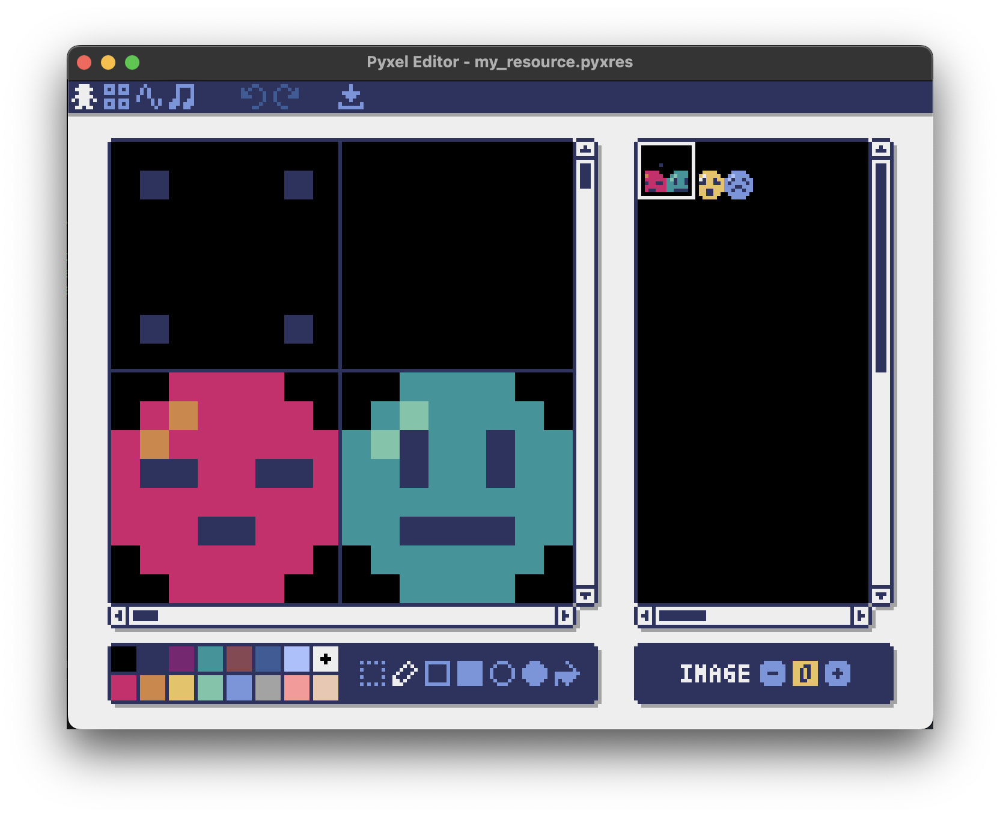
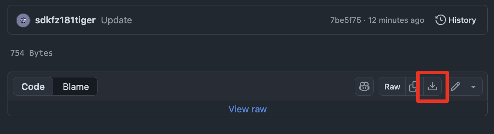
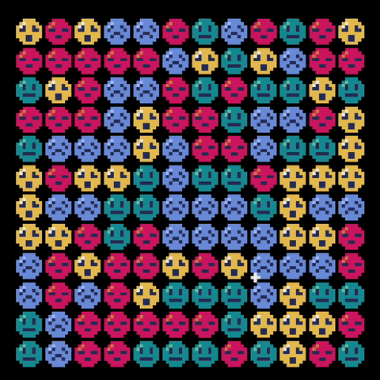

# 同じ色のアレをクリックで消していくやつ(サンプル)

今回は、どこかで見たパズルゲームの様なサンプルです。
(ここでは、サンプルコードのみの紹介です)

## 1, 素材を用意する

"Pyxel Editor"で、背景の素材を描きます。



# サンプルコード

今回のサンプルコードは、次の通りです。
(今回のサンプルコードには、別途`pytweening`ライブラリが必要です)

:::details 完成コード(main.py)
```python:main.py
import pyxel
import pytweening as tween
import random
import utility

ROWS = 12
COLS = 12
TILE_A = (0, 8)
TILE_B = (8, 8)
TILE_C = (16, 8)
TILE_D = (24, 8)
TILE_TYPES = [
    TILE_A, TILE_B, TILE_C, TILE_D
]

# Gameクラス
class Game:

    def __init__(self):
        """ コンストラクタ """
        # Pyxel初期化
        pyxel.init(120, 120, title="Hello, Pyxel!!")
        pyxel.load("my_resource.pyxres")

        self.w = pyxel.width
        self.h = pyxel.height

        # Tiles
        self.tiles = []
        s_x, s_y, pad = 7, 7, 9
        for r in range(ROWS):
            for c in range(COLS):
                x = s_x + c * pad
                y = s_y + r * pad
                type = random.choice(TILE_TYPES)
                tile = utility.Tile(x, y, type, r, c)
                self.tiles.append(tile)
        
        # Pyxel実行
        pyxel.run(self.update, self.draw)


    def update(self):
        """ 更新処理 """

        # Update
        for tile in self.tiles:
            tile.update()

        # Click
        if pyxel.btnp(pyxel.MOUSE_BUTTON_LEFT):
            for tile in self.tiles:
                if tile.is_tweening():
                    return
            m_x = pyxel.mouse_x
            m_y = pyxel.mouse_y
            for tile in self.tiles:
                if tile.is_inside(m_x, m_y):
                    type = tile.get_type()
                    print(f"r:{tile.r}, c:{tile.c}, type:{type}")
                    chains = self.count_chains(tile.r, tile.c, type, [])
                    count = len(chains)
                    if count < 2:
                       return
                    print(f"count:{count}")
                    # Set off
                    for r, c in chains:
                        print(f"chain: {r}, {c}")
                        tile = self.tiles[r * COLS + c]
                        tile.set_off() # Off
                    # Brow
                    self.brow()


    def draw(self):
        """ 描画処理 """
        pyxel.cls(0)

        # Tiles
        for tile in self.tiles:
            tile.draw()

        # マウス座標
        m_x = pyxel.mouse_x
        m_y = pyxel.mouse_y
        pyxel.circ(m_x, m_y, 1, 7)


    def count_chains(self, r, c, type, chains):
        #print(f"count_chains: {r}, {c}, type{type}")
        if r < 0: return chains
        if c < 0: return chains
        if ROWS - 1 < r: return chains
        if COLS - 1 < c: return chains
        if (r, c) in chains:
            return chains
        tile = self.tiles[r * COLS + c]
        if tile.is_off():
            return chains
        if tile.type != type:
            return chains
        chains.append((r, c))
        self.count_chains(r-1, c, type, chains)
        self.count_chains(r+1, c, type, chains)
        self.count_chains(r, c-1, type, chains)
        self.count_chains(r, c+1, type, chains)
        return chains


    def brow(self):
        #print(f"brow")
        for c in range(COLS):
            for r in range(ROWS-1, 0, -1):
                tile = self.tiles[r * COLS + c]
                if not tile.is_off():
                    continue
                self.brow_r(r, c)


    def brow_r(self, r, c):
        #print(f"Let's blow_r: {r}, {c}")
        to_t = r * COLS + c
        to_tile = self.tiles[to_t]
        for t in range(r, -1, -1):
            from_t = t * COLS + c
            from_tile = self.tiles[from_t]
            if self.tiles[from_t].is_off():
                continue
            # Swap
            from_tile.move_to(to_tile.x, to_tile.y, 0.4, tween.iterEaseInQuart)
            to_tile.x, to_tile.y = from_tile.x, from_tile.y
            from_tile.r, to_tile.r = to_tile.r, from_tile.r
            from_tile.c, to_tile.c = to_tile.c, from_tile.c
            self.tiles[from_t], self.tiles[to_t] = self.tiles[to_t], self.tiles[from_t]
            return


# Gameクラスを初期化
Game()
```
:::

:::details 完成コード(utility.py)
```python:utility.py
import pyxel
import pytweening as tween
import math

#==========
# BaseSpriteクラス
class BaseSprite:

    def __init__(self, x, y, u=0, v=0, w=8, h=8):
        """ コンストラクタ """
        self.x = x
        self.y = y
        self.u = u
        self.v = v
        self.w = w
        self.h = h
        self.vx = 0
        self.vy = 0
        self.hw = w / 2
        self.hh = h / 2

        # Animation
        self.anim_flg = False
        self.anim_index = 0
        self.anim_key = ""
        self.anims = {}

        # Tween
        self.t_frame = -1
        self.t_points = []

    
    def update(self):
        self.x += self.vx
        self.y += self.vy
        self.animate() # Animation
        self.tween() # Tween


    def draw(self):
        pyxel.blt(self.x, self.y, 0,
            self.u, self.v, self.w, self.h, 0)


    def move(self, spd, deg):
        rad = deg * math.pi / 180
        self.vx = spd * math.cos(rad) # x方向の速度
        self.vy = spd * math.sin(rad) # y方向の速度


    def stop(self):
        self.vx = 0
        self.vy = 0
        if -1 < self.t_frame:
            self.t_frame = -1


    def get_left(self):
        return (self.x, self.y + self.hh)


    def get_right(self):
        return (self.x + self.w - 1, self.y + self.hh)


    def get_top(self):
        return (self.x + self.hw, self.y)


    def get_bottom(self):
        return (self.x + self.hw, self.y + self.h - 1)


    #==========
    # Collision
    def get_min_x(self):
        return self.x


    def get_min_y(self):
        return self.y


    def get_max_x(self):
        return self.x + self.w


    def get_max_y(self):
        return self.y + self.h


    def collide(self, other):
        if other.get_max_x() < self.get_min_x():
            return False
        if other.get_max_y() < self.get_min_y():
            return False
        if self.get_max_x() < other.get_min_x():
            return False
        if self.get_max_y() < other.get_min_y():
            return False
        return True


    def is_inside(self, x, y):
            if x < self.get_min_x():
                return False
            if y < self.get_min_y():
                return False
            if self.get_max_x() < x:
                return False
            if self.get_max_y() < y:
                return False
            return True


    #==========
    # Animation
    def animate(self):
        if not self.anim_flg:
            return
        anims = self.anims[self.anim_key]
        frame = anims[self.anim_index]
        if frame is None:
            self.anim_flg = False
            self.anim_index = 0
            frame = anims[self.anim_index]
            return
        self.u = frame[0]
        self.v = frame[1]
        if pyxel.frame_count % 3 == 0:
            self.anim_index += 1
        if len(anims) <= self.anim_index:
            self.anim_index = 0


    def set_animation(self, key, animations):
        self.anims[key] = animations


    def start_animation(self, key):
        if not key in self.anims:
            return
        self.anim_flg = True
        self.anim_index = 0
        self.anim_key = key


    def stop_animation(self):
        self.anim_flg = False


    def toggle_animation(self):
        self.anim_flg = not self.anim_flg


    #==========
    # Tween
    def tween(self):
        if self.t_frame < 0:
            return
        if len(self.t_points) -1 <= self.t_frame:
            self.t_frame = -1
            return
        self.t_frame += 1
        self.x, self.y = self.t_points[self.t_frame]


    def move_to(self, x, y, sec, func):
        t_interval_size = 1 / (30 * sec)
        self.t_frame = 0
        self.t_points = list(func(
                    self.x, self.y, x, y, 
                    t_interval_size))


    def is_tweening(self):
        return 0 <= self.t_frame


#==========
# Camera
class CameraManager:

    def __init__(self, area_w, area_h, pad_x=16, pad_y=16):
        """ コンストラクタ """
        self.camera_x = 0
        self.camera_y = 0
        self.area_w = area_w
        self.area_h = area_h
        self.pad_x = pad_x
        self.pad_y = pad_y
        self.limit_l = pyxel.width - area_w
        self.limit_r = 0
        self.limit_t = pyxel.height - area_h
        self.limit_b = 0


    def set_center(self, spr):
        x = spr.x
        y = spr.y
        w = min(pyxel.width, self.area_w)
        h = min(pyxel.height, self.area_h)
        self.camera_x = w / 2 - x
        self.camera_y = h / 2 - y
        pyxel.camera(-self.camera_x, -self.camera_y)


    def camera_on(self, spr):
        x = spr.x
        y = spr.y
    
        line_l = 0 - self.camera_x + self.pad_x
        if x < line_l:
            self.camera_x += line_l - x
            if self.limit_r < self.camera_x:
                self.camera_x = self.limit_r

        line_r = pyxel.width - self.camera_x - self.pad_x
        if line_r < x:
            self.camera_x += line_r - x
            if self.camera_x < self.limit_l:
                self.camera_x = self.limit_l

        line_t = 0 - self.camera_y + self.pad_y
        if y < line_t:
            self.camera_y += line_t - y
            if self.limit_b < self.camera_y:
                self.camera_y = self.limit_b

        line_b = pyxel.height - self.camera_y - self.pad_y
        if line_b < y:
            self.camera_y += line_b - y
            if self.camera_y < self.limit_t:
                self.camera_y = self.limit_t

        pyxel.camera(-self.camera_x, -self.camera_y)
    
    
    def camera_off(self):
        pyxel.camera()
    

#==========
# Tilemap

def is_tile_type(x, y, type, types):
    tilemap = pyxel.tilemaps[0]
    u, v = x // 8, y // 8
    tile = tilemap.pget(u, v)
    if not(tile in types):
        return None, u, v
    return types[tile] == type, u, v


def collide_tile(spr, t_type, t_types, replace=None):
    tilemap = pyxel.tilemaps[0]
    x, y = spr.get_bottom()# x Bottom
    flg, u, v = is_tile_type(x, y, t_type, t_types)
    if flg and 0 < spr.vy:
        if replace:
            tilemap.pset(u, v, replace)
        else:
            spr.y = (v-1) * 8
            spr.vy = 0
        return True
    x, y = spr.get_top() # x Top
    flg, u, v = is_tile_type(x, y, t_type, t_types)
    if flg and spr.vy < 0:
        if replace:
            tilemap.pset(u, v, replace)
        else:
            spr.y = (v+1) * 8
            spr.vy = 0
        return True
    x, y = spr.get_left() # x Left
    flg, u, v = is_tile_type(x, y, t_type, t_types)
    if flg and spr.vx < 0:
        if replace:
            tilemap.pset(u, v, replace)
        else:
            spr.x = (u+1) * 8
            spr.vx = 0
        return True
    x, y = spr.get_right() # x Right
    flg, u, v = is_tile_type(x, y, t_type, t_types)
    if flg and 0 < spr.vx:
        if replace:
            tilemap.pset(u, v, replace)
        else:
            spr.x = (u-1) * 8
            spr.vx = 0
        return True
    return False

#==========
# Tile

class Tile(BaseSprite):

    def __init__(self, x, y, type, r, c):
        """ Constructor """
        self.type = type
        u, v = type
        self.r, self.c = r, c
        super().__init__(x, y, u, v, 8, 8)


    def get_type(self):
        return self.type

    
    def get_rc(self):
        return self.r, self.c


    def set_off(self):
        self.u = 0
        self.v = 0


    def is_off(self):
        return self.u == 0 and self.v == 0

```
:::

[完成したリソースファイルをダウンロード](https://github.com/sdkfz181tiger/Zenn/blob/main/images/books/675e49a3e4d34b/pce/shooter_samples/chap21_comp.zip) (右上の"ダウンロード"ボタンを押してダウンロードしてください)



実行結果は次のようになります。



# 終わりに...

ここまで読んでいただきありがとうございました。
この連載が、ゲーム開発のきっかけになれば幸いです。ޱ(ఠ皿ఠ)ว
(よろしければ👍頂けると大変励みになります!!)